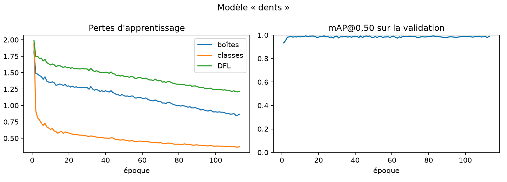
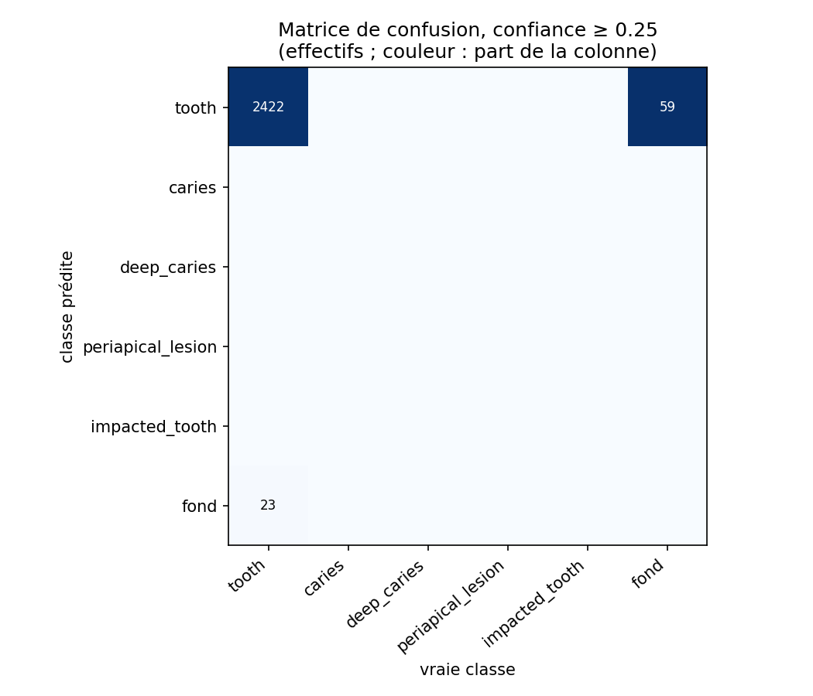
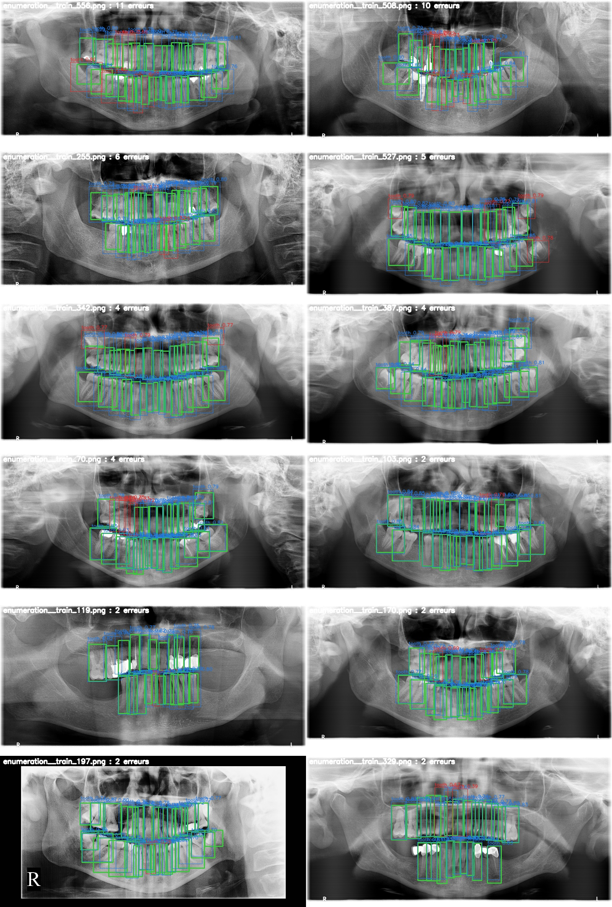
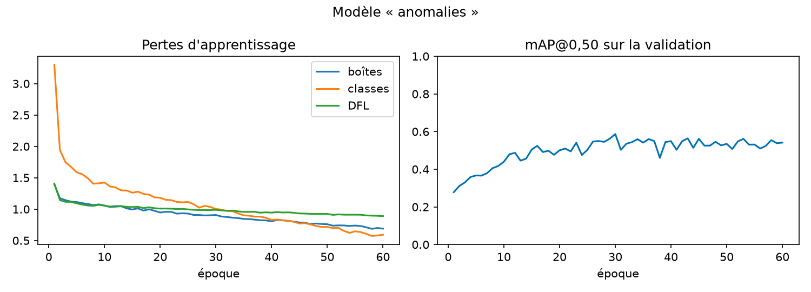
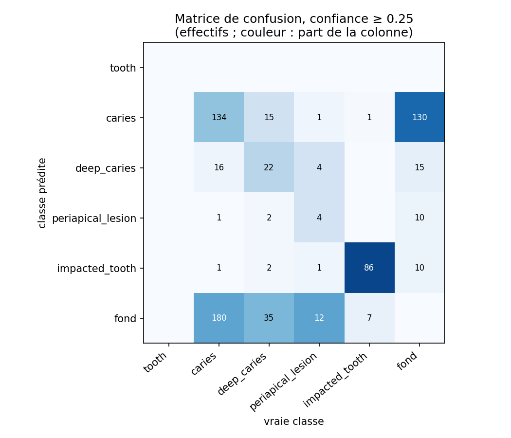
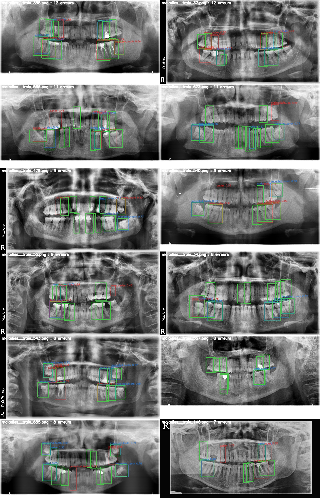

# Rapport d'évaluation — version `dentex-2026.11`

Version = paire de modèles YOLO11 : « dents » (numérotation) et « anomalies » (carie, carie profonde, lésion péri-apicale, dent incluse). Une détection est juste si sa classe est la bonne et si son cadre recouvre la vérité terrain à au moins 50 % (IoU).

## Données et découpage

- **Source** : DENTEX (Hugging Face `ibrahimhamamci/DENTEX`, révision `7b27ccc`), licence CC BY-NC-SA 4.0 — usage académique et non commercial ; les poids en héritent.
- **Deux jeux** : « dents » (toutes les dents encadrées, ensemble `quadrant_enumeration`) et « anomalies » (seulement les dents malades, `quadrant-enumeration-disease` + validation officielle).
- **Découpage** : un seul pour les deux jeux, par groupe de clichés identiques au pixel près, stratifié sur la classe la plus rare ; graine 42, empreinte `f22d373ede0ff715`.

## Modèle « dents »

| | |
|---|---|
| Modèle de départ | `yolo11s.pt` (préentraîné COCO) |
| Taille d'image · lot | 1024 px · 8 |
| Précision mixte | oui |
| Carte · versions | Tesla T4 · ultralytics 8.3.40, torch 2.14.1+cu130 |
| Époques réalisées | 113 sur 150 (arrêt anticipé après 30 sans progrès) |
| Meilleure époque | 83 (mAP@0,50 de validation 0,992) |
| Durée d'entraînement | 1 h 27 |
| Reprises après interruption | 0 |
| Commit | `8ebbaa7` |

### Test interne (87 clichés, évalué une fois)

| Classe | Instances | Précision | Rappel | mAP@0,50 | mAP@0,50:0,95 | Sensibilité (cliché) | Spécificité (cliché) |
|---|---|---|---|---|---|---|---|
| Dent | 2445 | 0,977 | 0,989 | 0,987 | 0,595 | 1,000 | — |
| **Global** | | 0,977 | 0,989 | 0,987 | 0,595 | | |

## Modèle « anomalies »

| | |
|---|---|
| Modèle de départ | `yolo11s.pt` (préentraîné COCO) |
| Taille d'image · lot | 1024 px · 8 |
| Précision mixte | oui |
| Carte · versions | Tesla T4 · ultralytics 8.3.40, torch 2.14.1+cu130 |
| Époques réalisées | 60 sur 150 (arrêt anticipé après 30 sans progrès) |
| Meilleure époque | 30 (mAP@0,50 de validation 0,587) |
| Durée d'entraînement | 1 h 06 |
| Reprises après interruption | 0 |
| Commit | `8ebbaa7` |

### Test interne (109 clichés, évalué une fois)

| Classe | Instances | Précision | Rappel | mAP@0,50 | mAP@0,50:0,95 | Sensibilité (cliché) | Spécificité (cliché) |
|---|---|---|---|---|---|---|---|
| Carie | 332 | 0,490 | 0,416 | 0,493 | 0,346 | 0,883 | 0,467 |
| Carie profonde | 76 | 0,465 | 0,401 | 0,371 | 0,235 | 0,609 | 0,809 |
| Lésion péri-apicale | 22 | 0,369 | 0,318 | 0,248 | 0,165 | 0,389 | 0,901 |
| Dent incluse | 94 | 0,846 | 0,932 | 0,927 | 0,624 | 0,952 | 0,895 |
| **Global** | | 0,542 | 0,517 | 0,510 | 0,343 | | |

### Comment lire ces chiffres — modèle « anomalies »

- **Le chiffre de référence est celui du test interne : mAP@0,50 = 0,510.** Ces clichés n'ont servi à rien d'autre, et le test n'a été évalué qu'une fois.
- La mAP de validation de la meilleure époque (0,587) est **optimiste** : c'est sur elle qu'ont été choisis l'époque retenue et l'arrêt anticipé.
- Sur la seconde moitié de l'entraînement, la mAP de validation forme un plateau de 0,535 en moyenne, avec des oscillations de ±0,02 d'une époque à l'autre : la meilleure époque est en partie un pic de ce bruit, ce qui explique l'écart avec le test.
- **Classes rares** : Lésion péri-apicale (22 boîtes au test) — quelques détections de plus ou de moins font varier leur mesure de plusieurs points ; elle indique une tendance, pas une valeur précise.

## Test externe (test officiel DENTEX, modèle « anomalies »)

Autre protocole d'annotation (polygones ramenés à leur cadre, taxonomie à huit codes) : seules les correspondances sûres sont mesurées — carie, dent incluse, lésion péri-apicale ; « küretaj » est exclu. Les chiffres ne se comparent pas directement à ceux du test interne.

| Classe | Instances | Précision | Rappel | mAP@0,50 | mAP@0,50:0,95 | Sensibilité (cliché) | Spécificité (cliché) |
|---|---|---|---|---|---|---|---|
| Carie | 747 | 0,444 | 0,485 | 0,458 | 0,338 | 0,880 | 0,500 |
| Lésion péri-apicale | 75 | 0,498 | 0,387 | 0,397 | 0,265 | 0,491 | 0,949 |
| Dent incluse | 221 | 0,776 | 0,941 | 0,901 | 0,592 | 0,956 | 0,830 |
| **Global** | | 0,573 | 0,604 | 0,585 | 0,399 | | |

## Limites

- **Prototype de recherche, non certifié dispositif médical.** Les détections sont des propositions ; la décision relève du praticien.
- **Une seule source de données** (DENTEX, un seul centre et un parc d'appareils limité) : la performance sur les clichés d'un autre cabinet reste à mesurer.
- **Classes rares** : les lésions péri-apicales sont peu nombreuses ; leurs mesures ont un large intervalle d'incertitude.
- **Test externe** : protocole d'annotation différent (polygones, taxonomie), correspondances limitées aux classes sûres.
- **Numérotation FDI** : déduite de la géométrie des boîtes, non apprise ; non évaluée ici (sprint 7).
